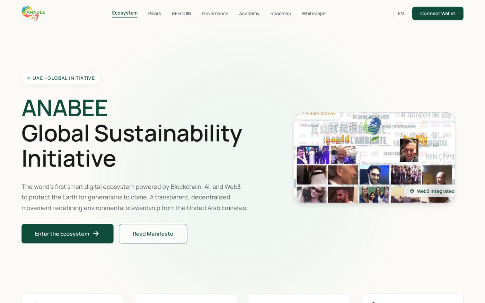

# anabee.org

Single-page light-themed landing site for [anabee.org](https://anabee.org).

Built from `design.html`, `design2.html`, and `design-dark.html` (light palette only).


## Screenshots



## Sections (one scroll)

Hero → Ecosystem → 7 Pillars → BEECOIN → Smart E-Court → Roadmap → **Academy** → ADNOC League → Whitepaper → Partners

## Academy (Frappe Learning)

Corporate video certification — modern UX, light Docker deploy:

```bash
cp academy/.env.example academy/.env   # optional
npm run academy:up                     # http://localhost:8000/lms
```

Customize in `site/academy.config.json`. Docs: `academy/README.md`. Moodle alternative: `academy/moodle/`.


## Local dev

```bash
npm run dev      # http://localhost:3456
```

## Deploy

```bash
netlify deploy --prod --dir=site
```

Files: `site/index.html`, `site/app.js`
